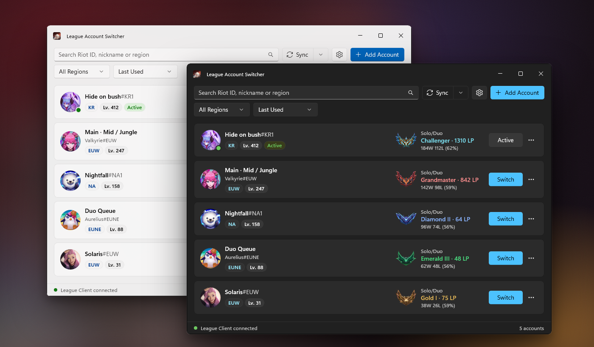
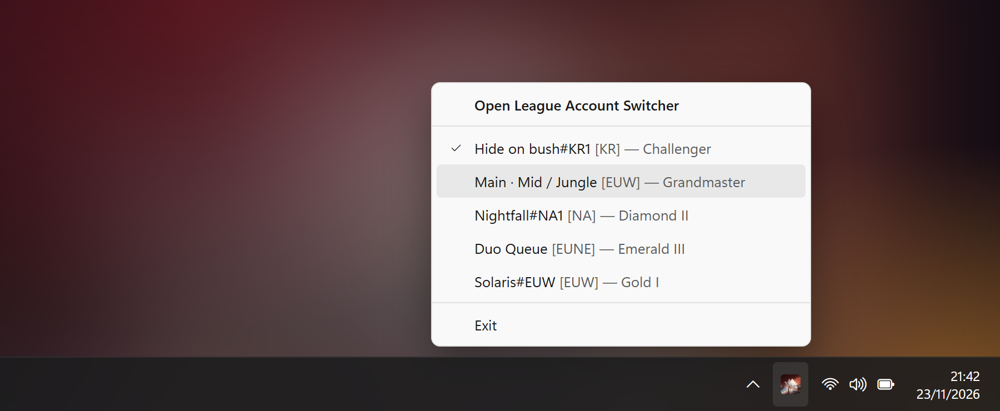
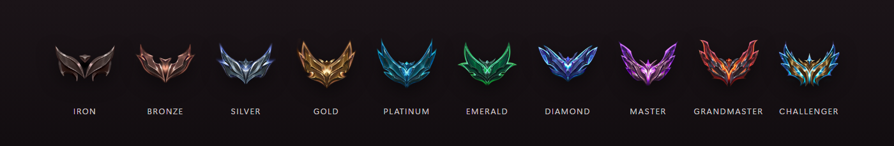

<div align="center">


# League Account Switcher

Switch between League of Legends accounts without typing a password.

<sub>Windows 10 / 11 &nbsp;·&nbsp; WinUI 3 &nbsp;·&nbsp; .NET 8</sub>

<br />



</div>

<br />

If you play on more than one account, you know the routine: sign out, type the
password, find your phone for the 2FA code, wait for the client, and do it all
again an hour later. This app skips all of that. You sign in to each account
once, and after that switching is a single click.

It doesn't store passwords. It saves the session Riot Client already keeps on
disk when you tick "Stay signed in", encrypts it for your Windows user, and swaps
it back in when you want that account.

## What you get

- One-click switching that works fine with 2FA, since no login screen is involved.
- Riot ID, region, level and Solo/Duo rank pulled from the League client while
  you play. No API key needed.
- A real Windows 11 app: Mica, dark and light themes, and a window that stays
  out of your way.
- Search, region filter and sorting by last used, rank, level or name, which helps
  once the list gets long.
- A tray menu, so you can switch without opening the window at all.

<br />

<div align="center">
  
  <br />
  <sub>Right-click the lotus in the tray. The checked account is the one you're on.</sub>
</div>

<br />

<div align="center">
  
  <br />
  <sub>Every account shows its current emblem, LP and win rate, updated whenever you log in.</sub>
</div>

## How switching works

Riot Client keeps your login in
`%LOCALAPPDATA%\Riot Games\Riot Client\Data\RiotGamesPrivateSettings.yaml`.
The switcher works with that file and nothing else.

1. When you save an account, it copies that file, checks the account's PUUID,
   and encrypts the copy with Windows DPAPI.
2. When you hit **Switch**, it first refreshes the saved copy of the account
   you're leaving. Riot rotates these tokens, so this keeps old saves from
   going stale.
3. It closes League and Riot Client, writes the other account's session back,
   and starts League again (or just Riot Client, if you set that in Settings).

It also asks before throwing away a sign-in you haven't saved, and it won't
close a running game without asking first.

### A few things to know

> [!IMPORTANT]
> Tick **"Stay signed in"** when you log in to Riot Client. Without it, Riot
> doesn't write a session to disk and there's nothing to save.

> [!WARNING]
> Don't click **Sign Out** inside Riot Client. That kills the session on Riot's
> side and the saved copy stops working. Switch from the app instead.

Vanguard isn't touched. The app only closes the normal Riot Client and League
processes, and never reads or writes game memory.

## Getting started

1. Sign in to Riot Client with "Stay signed in" ticked.
2. Open the switcher and go to **Add Account → Capture Current Session**. If
   League is running, your Riot ID, region, level and rank fill in on their own.
3. For the next account, use **Add Account → Sign In to New Account**. The app
   saves the current session, opens a clean Riot login, and picks up the new
   account once you're in.
4. Press **Switch** on any card, or use the tray menu.

There's an optional Riot API key field in Settings. You only need it if you want
rank and level refreshed for accounts you're not logged in to. It's stored
encrypted, like everything else.

## Building from source

You'll need the [.NET 8 SDK](https://dotnet.microsoft.com/download/dotnet/8.0)
(x64) on Windows 10 2004 (build 19041) or newer.

```powershell
dotnet build LeagueAccountSwitcher.sln -p:Platform=x64
dotnet run --project src/LeagueAccountSwitcher/LeagueAccountSwitcher.csproj -p:Platform=x64
dotnet test tests/LeagueAccountSwitcher.Tests/LeagueAccountSwitcher.Tests.csproj -p:Platform=x64
```

For a portable build you can hand to someone else:

```powershell
dotnet publish src/LeagueAccountSwitcher/LeagueAccountSwitcher.csproj `
  -c Release -r win-x64 -p:Platform=x64 --self-contained true `
  -o publish/LeagueAccountSwitcher-win-x64
```

Saved accounts and settings live in `%LOCALAPPDATA%\LeagueAccountSwitcher\`.
Delete that folder and the app forgets everything.

<details>
<summary>Project layout</summary>
<br />

```text
src/
  LeagueAccountSwitcher/        WinUI 3 app: window, dialogs, view models, tray icon
  LeagueAccountSwitcher.Core/   everything that isn't UI
    Services/Storage/           account list + DPAPI-encrypted sessions
    Services/RiotClient/        finding Riot Client, reading and writing its session file
    Services/Lcu/               talking to the running League client
    Services/Assets/            caching profile icons from Data Dragon
    Services/RiotApi/           optional rank refresh with an API key
tests/
  LeagueAccountSwitcher.Tests/  xUnit tests for storage, parsing and rank logic
```

</details>

---

<sub>
League Account Switcher isn't endorsed by Riot Games and doesn't reflect the
views or opinions of Riot Games or anyone officially involved in producing or
managing Riot Games properties. Riot Games, League of Legends and the ranked
emblems are trademarks or registered trademarks of Riot Games, Inc.
</sub>
