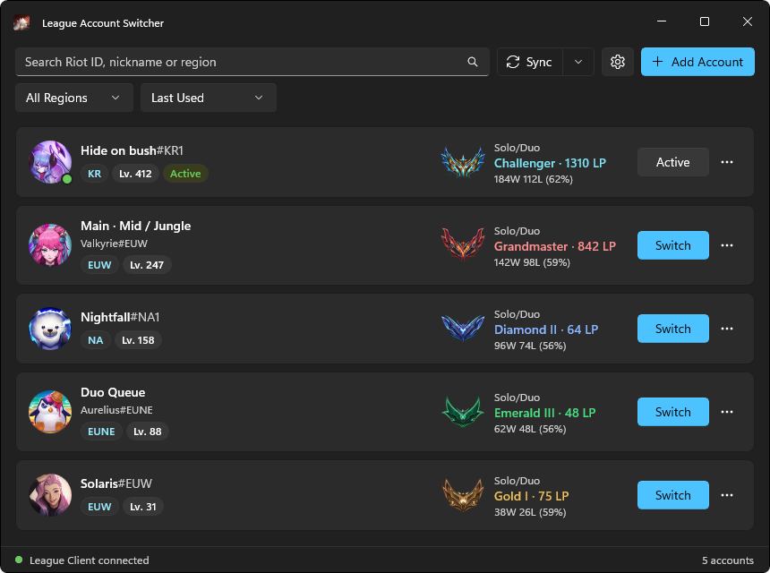
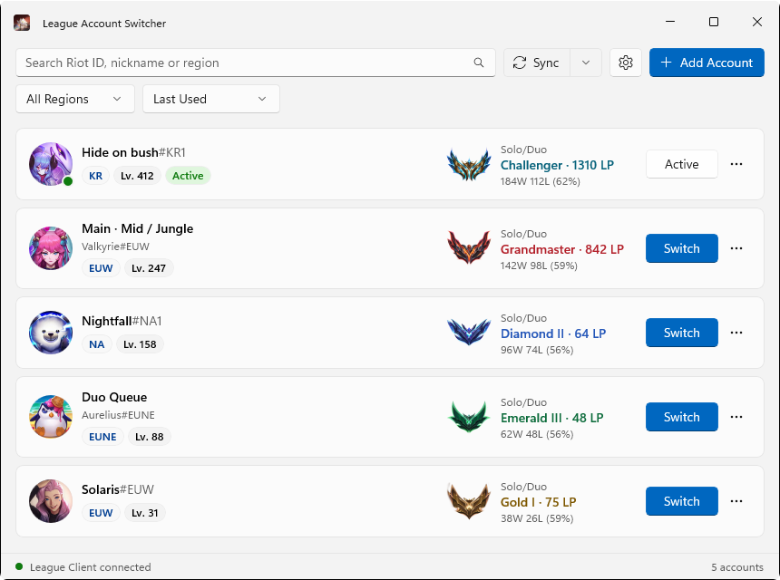

<div align="center">


# League Account Switcher

**Fast, native Windows 11 account switcher for League of Legends — built with WinUI 3.**  
Swap Riot Client sessions in one click with zero stored passwords, full 2FA support, and automatic **Region**, **Summoner Level**, and **Ranked Solo/Duo** tracking.

[](#requirements)
[](#key-features)
[](#requirements)
[](#build-run--distribute)
[](#how-switching-works)

</div>

---

## Preview

<div align="center">
  
</div>

<details>
<summary><b>View Light Mode & Side-by-Side Comparison</b></summary>
<br />

| Dark Mode | Light Mode |
| :---: | :---: |
|  |  |

</details>

---

## Key Features

- **One-Click Session Switching (Zero Passwords Stored)**  
  Captures Riot Client's *"Stay signed in"* session tokens (`RiotGamesPrivateSettings.yaml`) and encrypts each snapshot per Windows user via **Windows DPAPI** (`ProtectedData`). Works seamlessly with **2FA-enabled accounts** without ever typing or storing your password.
- **Zero-API-Key LCU Auto-Sync**  
  Automatically connects to the running local League Client (LCU) to sync **Riot ID (`GameName#Tag`)**, **Region**, **Summoner Level**, **Ranked Solo/Duo (Tier, Division, LP, Wins/Losses, Win Rate)**, and **Summoner Profile Icon** — no Riot Developer API key needed.
- **Native WinUI 3 Fluent Design & System Tray Quick-Switcher**  
  Features a Windows 11 **Mica** backdrop, **Dark / Light / System** theme modes, official League of Legends winged rank emblems (Unranked through Challenger), instant search & region filtering, sorting (*Last Used*, *Rank*, *Level*, *Name*), and a **System Tray** icon for background account switching.
- **Token Rotation Preservation & Match Protection**  
  Automatically backs up the outgoing account's latest rotated session token before switching, warns before discarding an unsaved sign-in, and guards against accidentally closing an active in-progress match.
- **Optional Riot API Refresh**  
  Optionally configure a Riot Developer API key (encrypted at rest via DPAPI) in **Settings** to refresh Ranked Solo/Duo stats and levels across inactive accounts without logging into them.

---

## How Switching Works

Instead of storing plaintext credentials or simulating fragile keyboard input in the Riot login window, **League Account Switcher** manages encrypted snapshots of Riot Client's persistent session file:

1. **Snapshot & Encrypt**: When you save an account, the app reads `%LOCALAPPDATA%\Riot Games\Riot Client\Data\RiotGamesPrivateSettings.yaml`, verifies the account's client `PUUID`, and encrypts the session payload to `%LOCALAPPDATA%\LeagueAccountSwitcher\sessions\<id>.bin` using **Windows DPAPI** (`DataProtectionScope.CurrentUser`).
2. **Preserve Outgoing Session**: When you click **Switch**, the app first updates the currently active account's encrypted snapshot so rotated Riot session cookies stay fresh.
3. **Graceful Client Swap**: It cleanly closes running League / Riot Client user-mode processes, writes the target account's decrypted session atomically, and relaunches League of Legends (or Riot Client only, configurable in Settings).

> [!IMPORTANT]
> - **Always check "Stay signed in"** when logging into Riot Client. Without it, Riot Client does not write persistent session cookies to disk for the switcher to capture.
> - **Switch through the app instead of clicking "Sign Out"** inside Riot Client — clicking *Sign Out* in Riot Client revokes that session token on Riot's servers.
> - **Vanguard Safe**: The switcher only manages standard Riot Client / League Client user-mode processes and **never** touches, stops, or modifies Riot Vanguard (`vgc` / `vgtray`) or any game memory.

---

## Quick Start

1. **Sign In**: Open Riot Client and sign in to your account with **"Stay signed in"** checked.
2. **Capture Current Session**: Launch **League Account Switcher** and click **Add Account → Capture Current Session** (if Riot Client or League Client is open, your Riot ID, Region, Level, and Solo/Duo Rank fill in automatically).
3. **Add Another Account**: Click **Add Account → Sign In to New Account** — the app safely backs up your current session, opens a clean Riot Client sign-in prompt, and saves the new account once you log in.
4. **Switch in One Click**: Click **Switch** on any account card (or right-click the **System Tray** lotus icon) to swap accounts and launch directly into League of Legends.

---

## Requirements

- **OS**: Windows 10 (version 2004 / build 19041+) or Windows 11 (**x64**)
- **SDK**: [.NET 8.0 SDK (x64)](https://dotnet.microsoft.com/en-us/download/dotnet/8.0)

---

## Build, Run & Distribute

```powershell
# 1. Build the solution (x64)
dotnet build LeagueAccountSwitcher.sln -p:Platform=x64

# 2. Run the WinUI 3 application
dotnet run --project src/LeagueAccountSwitcher/LeagueAccountSwitcher.csproj -p:Platform=x64

# 3. Run the unit test suite
dotnet test tests/LeagueAccountSwitcher.Tests/LeagueAccountSwitcher.Tests.csproj -p:Platform=x64

# 4. Publish a self-contained portable x64 release build
dotnet publish src/LeagueAccountSwitcher/LeagueAccountSwitcher.csproj `
  -c Release -r win-x64 -p:Platform=x64 --self-contained true `
  -o publish/LeagueAccountSwitcher-win-x64
```

All local metadata and encrypted session snapshots are stored under `%LOCALAPPDATA%\LeagueAccountSwitcher\`.

---

## Project Structure

```text
LeagueAccountSwitcher.sln
├── assets/
│   ├── screenshot-dark.png                  # WinUI 3 Dark Mode preview
│   └── screenshot-light.png                 # WinUI 3 Light Mode preview
├── src/
│   ├── LeagueAccountSwitcher/               # WinUI 3 desktop application (MVVM)
│   │   ├── Assets/
│   │   │   ├── AppIcon.ico / AppIcon.png    # Lotus application & titlebar icon
│   │   │   └── Ranks/                       # League of Legends tier emblems (Unranked..Challenger)
│   │   ├── Controls/                        # AccountCard, RankEmblemControl, AccountDetailsEditor
│   │   ├── Services/                        # AccountCoordinator, TrayIconService, DialogService
│   │   ├── ViewModels/                      # MainViewModel, AccountItemViewModel, Add/Settings VMs
│   │   ├── Views/                           # AddAccountDialog, EditAccountDialog, SettingsDialog
│   │   └── MainWindow.xaml                  # Mica main window, search/filter bar & account list
│   └── LeagueAccountSwitcher.Core/          # Core models & services (UI-independent)
│       ├── Models/                          # AccountRecord, RankedSoloInfo, AppSettings, LeagueRegion
│       └── Services/
│           ├── Storage/                     # AccountStore (atomic JSON + Windows DPAPI encryption)
│           ├── RiotClient/                  # RiotClientService, YAML session parser & path discovery
│           ├── Lcu/                         # LcuService (lockfile/process discovery & live stats sync)
│           ├── Assets/                      # AssetCacheService (Data Dragon summoner icon caching)
│           └── RiotApi/                     # RiotApiService (optional API refresh for inactive accounts)
└── tests/
    └── LeagueAccountSwitcher.Tests/         # xUnit tests for DPAPI storage, YAML/LCU parsing & rank logic
```
